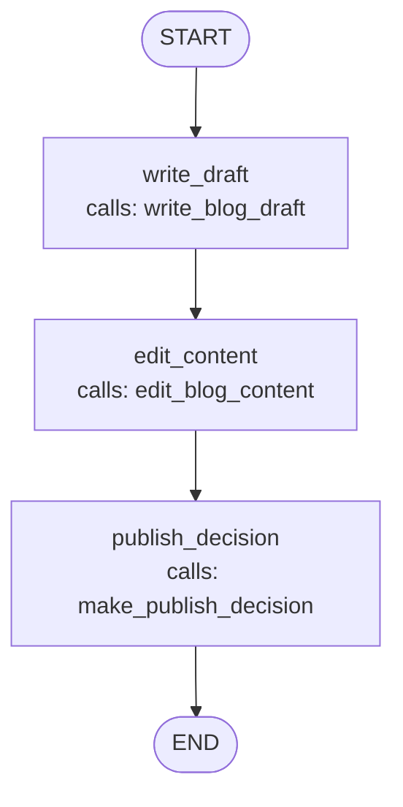

# Content Creation and Publication Workflow

The system addresses the need for an automated, multi-stage content review pipeline that leverages AI agents to collaborate in the content creation and publication workflow. Traditional content management processes require manual review and editing at multiple stages, leading to inefficiencies and delays.

The project implements a three-agent collaborative system where an AI writer generates initial blog content based on user-provided topics, an AI editor reviews and refines the content for clarity and quality, and an AI publisher evaluates the final draft to make publication decisions. Each agent operates in a sequential pipeline, with outputs from one agent serving as inputs to the next, ensuring a structured workflow that maintains message history and status tracking throughout the entire process.

The solution utilizes LangGraph for workflow orchestration, Google Gemini API for AI agent capabilities, and a TypedDict-based state schema to maintain consistency and type safety across the workflow pipeline.

## File Structure

```
.env
agents.py
graph.py
main.py
nodes.py
requirements.txt
state.py
tests.py
```

## Purpose of Files

| File | Purpose |
|---|---|
| `state.py` | Defines ContentState TypedDict schema for state |
| `agents.py` | Contains three agent functions for content work |
| `nodes.py` | Wraps agents with state management and mutations |
| `graph.py` | Constructs and compiles the workflow graph |
| `main.py` | Entry point, user interaction, and result display |
| `requirements.txt` | Project dependencies and versions |
| `.env` | API keys and configuration variables |

---

# Module Explanations

## state.py – State Schema Definition

### Purpose
This module defines the `ContentState` TypedDict that specifies the shape and structure of state data flowing through the workflow. It establishes the contract for all state mutations and field definitions.

### Class Structure
```
Class: ContentState (TypedDict)
├── messages: Annotated[list[BaseMessage], add_messages]
│   └── Reducer: add_messages - Intelligently merges message lists
├── topic: str
├── draft: str
├── edited_version: str
└── status: Literal["drafting", "editing", "reviewing", "published", "rejected"]
```

### Field Definitions

| Field Name | Data Type | Purpose | Reducer/Behavior |
|---|---|---|---|
| messages | list[BaseMessage] | Message history tracking | add_messages (accumulates) |
| topic | str | Blog topic from user | Preserved throughout |
| draft | str | Writer agent output | Empty initially, filled |
| edited_version | str | Editor agent output | Empty initially, filled |
| status | Literal (5 values) | Workflow state machine | Transitions at each stage |

### Key Characteristics
1. TypedDict is a structural type definition for dictionary validation
2. `Annotated[...]` allows metadata attachment to types
3. `add_messages` is a reducer function that appends messages to existing list
4. Status values follow progression: drafting → editing → reviewing → published/rejected
5. Five required fields enforced at runtime by LangGraph validation

---

## agents.py – AI Agent Functions Module

### Purpose
This module contains three independent AI agent functions that interface with the Google Gemini API. Each function is a pure function that accepts text input, constructs a specialized prompt with role assignment and requirements, and returns processed output from the Gemini model.

### Function 1: `write_blog_draft()`

**Function Signature:**
```python
write_blog_draft(topic: str) -> str
```

**Parameter Explanation:**
```
topic (str)
 │  What: Blog topic provided by user
 │  From: ContentState[topic] passed from write_draft node
 │  Type: Plain string
 └  Usage: Interpolated into prompt for blog generation
```

**Logic Explanation:**
1. Constructs prompt with three components:
   - a) Role assignment: "You are a professional blog writer"
   - b) Specific requirements: 150-200 words, title, intro, 3 points, conclusion
   - c) Topic interpolation: User-provided topic string inserted
2. *Reads the model id from the `GEMINI_MODEL` environment variable*
3. *Call `client.models.` (synchronous blocking call)*
4. *Extracts `.text` attribute from response object*
5. Returns plain text of generated blog draft

**Return Type:** `str` (plain text containing generated blog content)
```
└ Content: 150-200 word blog with structure: title, intro, 3 key points, conclusion
```

### Function 2: `edit_blog_content()`

**Function Signature:**
```python
edit_blog_content(draft: str) -> str
```

**Parameter Explanation:**
```
draft (str)
 │  What: Blog draft generated by write_blog_draft agent
 │  From: ContentState[draft] passed from edit_content node
 │  Type: Plain string containing blog content
 └  Usage: Full draft content interpolated into editing prompt
```

**Logic Explanation:**
1. Constructs prompt with role-based instructions:
   - a) Role assignment: "You are a professional editor"
   - b) Focus areas specified: grammar, clarity, flow, word choices, tone
   - c) Draft content included in prompt
2. Explicit constraint added: "Return only the improved blog post without explanations"
3. *Reads the model id from the `GEMINI_MODEL` environment variable*
4. *Call `client.models` (synchronous blocking call)*
5. *Extracts `.text` attribute from response object*
6. Returns improved version of draft

**Return Type:** `str` (improved blog content with enhanced grammar and clarity)
```
└ Content: Same structure as input draft but with quality improvements
```

### Function 3: `make_publish_decision()`

**Function Signature:**
```python
make_publish_decision(edited_content: str) -> tuple[str, str]
```

**Parameter Explanation:**
```
edited_content (str)
 │  What: Edited blog content from edit_blog_content agent
 │  From: ContentState[edited_version] passed from publish_decision node
 │  Type: Plain string containing complete blog content
 └  Usage: Full content included in evaluation prompt
```

**Logic Explanation:**
1. Constructs prompt with evaluation framework:
   - a) Role assignment: "You are a publisher"
   - b) Evaluation criteria: quality, clarity, structure, engagement, completeness
   - c) Content included for review
2. Specifies strict output format:
   - Required: `"DECISION: [PUBLISH or REJECT]"`
   - Required: `"REASONING: [One sentence explanation]"`
3. *Reads the model id from the `GEMINI_MODEL` environment variable*
4. *Call `client.models` (synchronous blocking call)*
5. *Strips whitespace from response text*
6. Parses response for decision extraction:
   - a) Searches for "PUBLISH" keyword in response text
   - b) If found: sets decision to "published" (lowercase)
   - c) If not found: sets decision to "rejected" (lowercase)
7. Parses response for reasoning extraction:
   - a) Splits response into lines
   - b) Filters lines containing "REASONING:" substring
   - c) Takes first matching line, removes "REASONING:" prefix, strips whitespace
   - d) If no match found: uses default "Content review complete"
8. Returns tuple of `(decision, reasoning)`

**Return Type:** `tuple[str, str]`
```
├── Index 0 (str): "published" or "rejected"
└── Index 1 (str): Reasoning text explanation or default message
```

---

## nodes.py – Workflow Node Functions Module

### Purpose
This module contains three node functions that orchestrate the workflow by extracting state data, calling corresponding agents, and returning state mutations. Each node acts as a bridge between the state management system and the AI agents.

### Function 1: `write_draft()`

**Function Signature:**
```python
write_draft(state: ContentState) -> dict
```

**Parameter Explanation:**
```
state (ContentState)
 │  What: Current workflow state object
 │  From: Initial state or previous node output
 │  Type: TypedDict with 5 required fields
 │  Reading: state[topic] extracted for agent input
 └  Expected Fields: messages, topic, draft, edited_version, status
```

**Logic Explanation:**
1. Extracts topic from state: `state[topic]`
2. Invokes Agent 1: `write_blog_draft(state[topic])`
3. Receives draft text output from agent
4. Constructs return dictionary with three updates:
   - a) Sets draft field to agent output
   - b) Adds AIMessage to messages for tracking
   - c) Transitions status from "drafting" to "editing"
5. Returns partial state dict (LangGraph merges with existing state)

**Return Type:** `dict` (partial state update)
```
├── draft: str (agent output)
├── messages: list[AIMessage] (new message to append)
└── status: str ("editing")
```

**State Mutation Effect:**
```
BEFORE:    draft = "", status = "drafting", messages = [1 message]
AFTER:     draft = "generated blog", status = "editing", messages = [2 messages]
UNCHANGED: topic preserved, edited_version remains empty
```

### Function 2: `edit_content()`

**Function Signature:**
```python
edit_content(state: ContentState) -> dict
```

**Parameter Explanation:**
```
state (ContentState)
 │  What: Current workflow state from previous node
 │  From: Output after write_draft node execution
 │  Type: TypedDict with draft field populated
 │  Reading: state[draft] extracted for agent input
 └  Expected State: Contains draft from Agent 1
```

**Logic Explanation:**
1. Extracts draft from state: `state[draft]` (Agent 1 output)
2. Invokes Agent 2: `edit_blog_content(state[draft])`
3. Receives improved content from agent
4. Constructs return dictionary with three updates:
   - a) Sets edited_version field to agent output
   - b) Adds AIMessage to messages for tracking
   - c) Transitions status from "editing" to "reviewing"
5. Returns partial state dict (LangGraph merges with existing state)

**Return Type:** `dict` (partial state update)
```
├── edited_version: str (agent output)
├── messages: list[AIMessage] (new message to append)
└── status: str ("reviewing")
```

**State Mutation Effect:**
```
BEFORE:    edited_version = "", status = "editing", messages = [2 messages]
AFTER:     edited_version = "improved blog", status = "reviewing", messages = [3 messages]
UNCHANGED: topic and draft preserved
```

### Function 3: `publish_decision()`

**Function Signature:**
```python
publish_decision(state: ContentState) -> dict
```

**Parameter Explanation:**
```
state (ContentState)
 │  What: Current workflow state from previous node
 │  From: Output after edit_content node execution
 │  Type: TypedDict with all content fields populated
 │  Reading: state[edited_version] extracted for agent input
 └  Expected State: Contains edited_version from Agent 2
```

**Logic Explanation:**
1. Extracts edited_version from state: `state[edited_version]`
2. Invokes Agent 3: `make_publish_decision(state[edited_version])`
3. Receives tuple `(decision, reasoning)` from agent
4. Unpacks tuple: `decision_str, reasoning_str = agent_output`
5. Constructs return dictionary with two updates:
   - a) Sets status field to decision value (published or rejected)
   - b) Adds AIMessage containing reasoning to messages
   - c) Message format: `f"Publisher: {reasoning_text}"`
6. Returns partial state dict (LangGraph merges with existing state)

**Return Type:** `dict` (partial state update)
```
├── status: str ("published" or "rejected")
└── messages: list[AIMessage] (message with reasoning)
```

**State Mutation Effect:**
```
BEFORE:    status = "reviewing", messages = [3 messages]
AFTER:     status = "published"/"rejected", messages = [4 messages]
UNCHANGED: All content fields (topic, draft, edited_version) preserved
```

### Node Execution Pattern
All three nodes follow identical pattern:
1. Extract input from state
2. Call corresponding agent function
3. Receive output from agent
4. Package output in return dictionary
5. Return dict for LangGraph to merge with state
6. Transition status to next stage
7. Append message to message history

---

## graph.py – Graph Construction and Compilation Module

### Purpose
This module constructs and compiles the workflow graph using LangGraph's StateGraph class. It defines the topology (nodes and edges), registers node functions, and returns a compiled executable workflow object.

### Function: `build_workflow()`

**Function Signature:**
```python
build_workflow() -> CompiledStateGraph
```

**Parameters:** None

**Logic Explanation:**
```
Step 1: Instantiate StateGraph
 ├── Creates new StateGraph with ContentState type parameter
 ├── Initializes empty directed graph structure
 └── Sets state schema to ContentState TypedDict

Step 2: Register Node Functions
 ├── Add node named "write" with write_draft function
 ├── Add node named "edit" with edit_content function
 ├── Add node named "publish" with publish_decision function
 └── Each node linked to corresponding function by name and reference

Step 3: Define Graph Edges (Topology)
 ├── Add edge: START → "write" (entry point to first node)
 ├── Add edge: "write" → "edit" (sequential transition)
 ├── Add edge: "edit" → "publish" (sequential transition)
 └── Add edge: "publish" → END (exit point from last node)

Step 4: Compile Workflow
 ├── Call .compile() method on graph
 ├── Validates graph structure (all referenced nodes exist)
 ├── Validates state mutations (all nodes return compatible dicts)
 ├── Checks for invalid cycles
 ├── Optimizes execution plan
 └── Returns CompiledStateGraph ready for invocation
```

**Return Type:** `CompiledStateGraph` (compiled executable workflow)
```
├── Methods available: .invoke(state), .stream(state)
├── Immutable after compilation
└── Contains complete execution plan
```

### Graph Properties
- **Type:** Directed Acyclic Graph (DAG)
- **Topology:** Linear Sequential Pipeline
- **Path:** START → write → edit → publish → END
- **Nodes:** 3 (no branching or decision nodes)
- **Edges:** 4 (unconditional sequential edges)
- **Execution:** Always follows same path, no conditionals

### Workflow Diagram



---

## main.py – Entry Point and Orchestration Module

### Purpose
This module serves as the entry point for the application. It orchestrates the workflow execution by collecting user input, initializing the state, invoking the compiled workflow, and displaying formatted results.

### Function: `run_content_review_pipeline()`

**Function Signature:**
```python
run_content_review_pipeline() -> None
```

**Parameters:** None

**Logic Explanation:**
```
Step 1: Collect User Input
 ├── Calls input() function to prompt user
 ├── Displays prompt: "Enter blog topic: "
 ├── Waits for user to enter topic string (blocking)
 ├── Strips leading and trailing whitespace with .strip()
 └── Stores in topic variable

Step 2: Build Workflow
 ├── Calls build_workflow() from graph module
 ├── Receives compiled StateGraph object
 ├── Stores in workflow variable
 └── Workflow now ready for invocation

Step 3: Initialize State
 ├── Creates dictionary matching ContentState schema
 ├── messages field: Wraps user input in HumanMessage
 │   └── Message content: f"Write about: {topic}"
 ├── topic field: User-provided topic string
 ├── draft field: Empty string ""
 ├── edited_version field: Empty string ""
 └── status field: "drafting" (initial state value)

Step 4: Execute Workflow
 ├── Calls workflow.invoke(initial_state)
 ├── Synchronous execution (blocks until complete)
 ├── Executes all three nodes in sequence:
 │   ├── Node 1: Calls write_draft with topic
 │   ├── Node 2: Calls edit_content with draft
 │   └── Node 3: Calls publish_decision with edited version
 ├── Returns final state dict with all fields populated
 └── Stores in final_state variable

Step 5: Display Results
 ├── Prints decorative header separators
 ├── Prints user-provided topic
 ├── Prints WRITER'S DRAFT section: final_state[draft]
 ├── Prints EDITOR'S IMPROVEMENTS section: final_state[edited_version]
 ├── Prints PUBLISHER'S DECISION section:
 ...
```

> ⚠️ The rest of Step 5 was cut off in the screenshots.

---

# Input Format and Output Format

## Input Format
User provides a single string input through console prompt:
- **Prompt:** `"Enter blog topic: "`
- **Input Type:** `str` (plain text)
- **Example Input:** `"Artificial Intelligence in Healthcare"`
- **Constraints:** Any non-empty string accepted
- **Processing:** Whitespace trimmed with `.strip()`

## Output Format
The system produces formatted console output in six sections:

**Section 1: Header Separator**
- Format: Line of 70 equals signs
- Content: `"CONTENT REVIEW PIPELINE COMPLETE"`

**Section 2: Topic Display**
- Format: `"Topic: {user_provided_topic}"`
- Source: `final_state[topic]`

**Section 3: Writer's Draft**
- Format: `"WRITER'S DRAFT:"` header with separator
- Content: `final_state[draft]`
- Description: 150-200 word blog post with title, intro, 3 points, conclusion

**Section 4: Editor's Improvements**
- Format: `"EDITOR'S IMPROVEMENTS:"` header with separator
- Content: `final_state[edited_version]`
- Description: Same blog content with grammar, clarity, and flow improvements

**Section 5: Publisher's Decision**
- Format: `"PUBLISHER'S DECISION:"` header with separator
- Content: `"Status: {PUBLISHED or REJECTED}"` (uppercase)
- Decision: Two possible values - published or rejected

**Section 6: Message Trail**
- Format: `"Message Trail:"` label with bulleted list
- Content: All accumulated messages with bullet points
- Count: 4 messages total
  - 1 HumanMessage (initial)
  - 3 AIMessages (one from each agent)

---

# Sample Input and Output

## Sample Input Execution

User enters at prompt:
```
Enter blog topic: Machine Learning Applications
```

## Sample Output

```
CONTENT REVIEW PIPELINE COMPLETE
Topic: Machine Learning Applications

WRITER'S DRAFT:
Machine Learning Applications: Transforming Modern Technology

Machine learning has become a cornerstone of technological advancement in the
21st century. From healthcare diagnostics to autonomous vehicles, machine
learning applications are revolutionizing industries and improving human lives.

Key Points:
1. Healthcare: ML algorithms analyze medical images and predict disease outcomes
2. Finance: Fraud detection and algorithmic trading systems rely on ML models
3. Retail: Recommendation systems personalize customer experiences

Machine learning continues to evolve, offering unprecedented opportunities for
innovation and problem-solving across virtually every sector.

EDITOR'S IMPROVEMENTS:
Machine Learning Applications: Transforming Modern Industries

Machine learning has emerged as a cornerstone of technological innovation in
the twenty-first century. From disease diagnosis in healthcare to autonomous
vehicle navigation, machine learning applications are fundamentally
transforming industries and substantially improving human outcomes.

Critical Applications:
1. Healthcare: Advanced ML algorithms accurately analyze medical imaging and
   provide predictive disease assessments
2. Finance: Sophisticated fraud detection and algorithmic trading systems
   leverage cutting-edge machine learning models
3. Retail: Intelligent recommendation engines deliver highly personalized
   customer shopping experiences

Machine learning continues rapid evolution, presenting extraordinary
opportunities for innovation and sophisticated problem-solving across all
economic sectors.

PUBLISHER'S DECISION:
Status: PUBLISHED

Message Trail:
  • Write about: Machine Learning Applications
  • Writer: Initial draft created
  • Editor: Content refined for clarity and quality
  • Publisher: The blog demonstrates excellent clarity, strong structure, and
    high engagement level making it suitable for publication
```

---

# Implementation Instructions

## Environment Setup

1.1 Navigate to project directory:
```bash
cd Project
```

1.2 Install dependencies from requirements.txt:
```bash
pip install -r requirements.txt
```

> ⚠️ The remaining implementation instructions were cut off in the screenshots.
